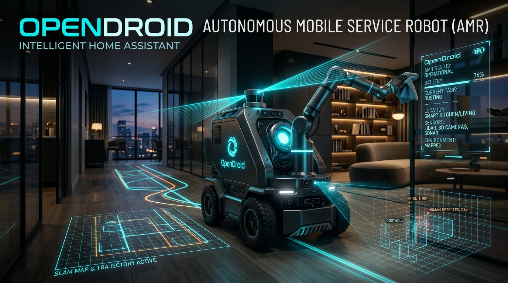
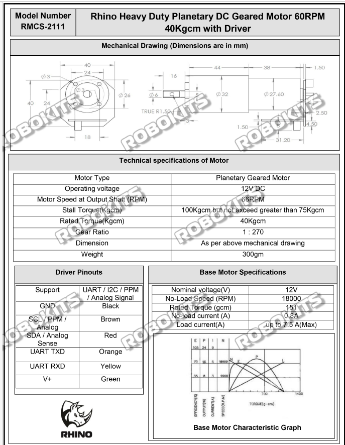

<div align="center">

# 🤖 OpenDroid: Autonomous Mobile Service Robot (AMR)
### *Next-Generation Household Assistive Robot with 6-Wheel Differential Kinematics, ROS 2 Navigation, Closed-Loop Planetary Actuation & Edge Computer Vision*



[](https://docs.ros.org/en/humble/)
[](https://ubuntu.com/)
[](https://en.cppreference.com/w/cpp/17)
[](https://www.python.org/)
[](https://gazebosim.org/)
[](https://opencv.org/)
[-00B4D8?style=for-the-badge)](assets/docs/RMCS_2111_Motor_Driver_Manual.pdf)
[](LICENSE)

---

### 🌐 **Autonomous Indoor Navigation • Door Opening Assistance • Item Fetching & Delivery • Edge AI Vision**

</div>

## 📌 Executive Summary & Project Genesis

**OpenDroid** is a robotics engineering platform developed as an intensive engineering internship project. The primary objective is the complete architectural design, kinematic modeling, dynamic simulation, embedded hardware interfacing, and real-time computer vision deployment of an **autonomous indoor service robot (AMR)**.

Built to address real-world domestic, healthcare, and office environments, OpenDroid is engineered to perform complex multi-task household routines:
* 🚪 **Door Opening & Traversal**: Autonomous door handle recognition, pose estimation, and threshold negotiation.
* 📦 **Object Fetching & Carrying**: Real-time identification of domestic items (cups, bottles, toolboxes) and payload transport.
* 💡 **Assistive Device & Switch Interaction**: Precision spatial alignment to interface with environmental switches and human-care utilities.
* 🗺️ **Autonomous Exploration & Semantic Mapping**: Dense 2D/3D indoor SLAM with obstacle avoidance across narrow hallways and dynamic environments.

---

## 🏛️ System Architecture & Data Flow Pipeline

OpenDroid employs a hierarchically decoupled architecture separating low-level deterministic motor control and high-level autonomous perception and mission orchestration:

```
+--------------------------------------------------------------------------------------------------+
|                                    HARDWARE PERCEPTION & SENSORS                                  |
|   +-----------------------+     +------------------------+     +-------------------------------+ |
|   | 2D 360° LiDAR Scanner |     | Intel RealSense D415   |     | 9-DOF IMU (Accelerometer,     | |
|   | (16m Range, 30 Hz)    |     | (RGB-D + Stereo Vision)|     | Gyroscope & Magnetometer)     | |
|   +-----------+-----------+     +-----------+------------+     +---------------+---------------+ |
+---------------|-----------------------------|----------------------------------|-----------------+
                |                             |                                  |
                v                             v                                  v
+--------------------------------------------------------------------------------------------------+
|                                  HOST SBC / HIGH-LEVEL EDGE COMPUTE                               |
|                                (NVIDIA Jetson / Raspberry Pi 4/5 / x86 PC)                       |
|                                                                                                  |
|   +------------------------------------+      +----------------------------------------------+   |
|   |      COMPUTER VISION PIPELINE      |      |           ROS 2 AUTONOMOUS STACK             |   |
|   | - YOLOv8 Deep Learning Inference   |      | - SLAM Toolbox (Online Asynchronous Mapping) |   |
|   | - OpenCV Spatial Contour Analysis  |=====>| - Nav2 (NavFn Global + DWB Local Controller) |   |
|   | - ArUco / AprilTag Visual Docking  |      | - Costmap2D Dynamic Obstacle Inflation       |   |
|   | - 3D Visual Servoing & Centroids   |      | - Behavior Trees & Recovery Maneuvers        |   |
|   +------------------------------------+      +----------------------+-----------------------+   |
|                                                                      |                           |
|                                         Twist [/cmd_vel] Topics     |                           |
+----------------------------------------------------------------------|---------------------------+
                                                                       | UART / USB-CDC Bridge
                                                                       v
+--------------------------------------------------------------------------------------------------+
|                                LOW-LEVEL EMBEDDED CONTROLLER (MCU)                               |
|                                    (ESP32 / STM32 Dual-Core)                                     |
|                                                                                                  |
|   +------------------------------------------------------------------------------------------+   |
|   | - Inverse Differential Kinematics Solver (Track Width: 0.60m, Wheel Radius: 0.10m)      |   |
|   | - Hardware Safety Watchdog (500ms Communication Timeout Brake)                           |   |
|   | - Closed-Loop High-Frequency Velocity PID Regulation                                     |   |
|   +------------------------------------+-----------------------------------------------------+   |
+----------------------------------------|---------------------------------------------------------+
                                         | Dual UART (9600 Baud) / I2C Control
                                         v
+--------------------------------------------------------------------------------------------------+
|                               ACTUATION & CLOSED-LOOP MOTOR DRIVERS                              |
|                                                                                                  |
|   +--------------------------------------+     +---------------------------------------------+   |
|   | Left Rhino RMCS-2111 Planetary Driver|     | Right Rhino RMCS-2111 Planetary Driver      |   |
|   | - 12V DC, 1:270 Planetary Gearbox    |     | - 12V DC, 1:270 Planetary Gearbox           |   |
|   | - 40 Kg-cm Rated / 100 Kg-cm Stall   |     | - 40 Kg-cm Rated / 100 Kg-cm Stall          |   |
|   | - Integrated Quadrature Encoders     |     | - Integrated Quadrature Encoders            |   |
|   +------------------+-------------------+     +---------------------+-----------------------+   |
|                      |                                               |                           |
|                      v                                               v                           |
|           [200mm Center Drive Wheel]                      [200mm Center Drive Wheel]             |
|                                                                                                  |
|              +-----------------------------------------------------------------+                 |
|              |  + 4 Corner Low-Friction Castors for Zero-Pitch Stability Deck  |                 |
|              +-----------------------------------------------------------------+                 |
+--------------------------------------------------------------------------------------------------+
                                         |
                                         v
                   [ IoT Cloud Telemetry: MQTT / WebSockets / ROSbridge ]
```

---

## ⚡ Core Engineering Features

* 🚀 **Real-Time Edge Inference**: Lightweight YOLOv8 and OpenCV pipeline capable of running on edge SoCs (NVIDIA Jetson, Raspberry Pi) to classify household assets, localize door knobs, and align robotic manipulators.
* 🔄 **Low-Latency Sensor Fusion**: Fuses 2D LiDAR point clouds, 6-DOF IMU acceleration/rates, and quadrature wheel odometry using an Extended Kalman Filter (`robot_localization`) for centimeter-accurate localization in GPS-denied indoor spaces.
* 🦾 **Closed-Loop Planetary Actuation**: Powered by dual **Rhino RMCS-2111** planetary geared DC servomotors delivering up to **100 Kg-cm stall torque** with high-precision internal encoder feedback over UART ASCII/Modbus protocols.
* ⚖️ **Rock-Solid 6-Wheel Stability Platform**: Unique kinematic footprint featuring two center differential drive wheels with four corner trolley casters preventing tipping or pitch instability during high-payload manipulation or door pushing/pulling.
* 🌐 **Hardware-in-the-Loop (HIL) & Multi-Simulator Parity**: Full URDF/XACRO model compatible with **ROS 2 Humble**, **Gazebo Classic 11**, **Ignition / GZ Fortress & Harmonic**, and photorealistic **NVIDIA Isaac Sim (Omniverse USD)**.
* 📡 **Edge-to-Cloud Telemetry**: Asynchronous communication bridge facilitating remote diagnostics, battery monitoring, live map streaming, and mission abort triggers.

---

## 📐 Mechanical & Kinematic Specifications

Extracted directly from the robot's physical URDF specification ([`bcr_bot.xacro`](file:///c:/Users/Samim%20Akhtar/Desktop/OpenDroid/bcr_bot-ros2%20black%20cofee%20robotics/bcr_bot-ros2/urdf/bcr_bot.xacro)):

| Metric / Parameter | Value | Engineering Significance |
| :--- | :--- | :--- |
| **Chassis Dimensions** | `900 mm × 640 mm × 190 mm` | Sized to clear standard 750–800mm domestic doorways easily |
| **Total Chassis Mass** | `70.0 kg` (Base) | High downward normal force ensuring maximum wheel traction |
| **Drive Wheel Diameter** | `200 mm` (Radius: `0.10 m`) | Capable of rolling over carpets, cables, and 15mm thresholds |
| **Drive Track Width** | `600 mm` (`0.60 m`) | Wide stance for high turning stability and zero-slip rotation |
| **Drive Wheel Width** | `50 mm` (`0.05 m`) | High-friction polyurethane contact surface |
| **Corner Caster Diameter**| `120 mm` (Radius: `0.06 m`) | Low-friction 4-corner stabilization with `0.54 m` track width |
| **Wheelbase** | `880 mm` (`0.88 m`) | Longitudinal pitch stability under dynamic acceleration |
| **Rated Output Speed** | `66 RPM` (`~0.69 m/s`) | Safe domestic operational speed with rapid response |
| **Rated Output Torque** | `40 Kg-cm` (Stall: `100 Kg-cm`)| High payload carrying (up to 50kg cargo) and door push capacity |
| **Gear Reduction Ratio**| `1 : 270` | Planetary multi-stage reduction for zero backdrive drift |

---

## 📋 Bill of Materials (BOM) & Pinout Interface Map

### Hardware Bill of Materials

| Category | Component Description | Model / Part No. | Operating Voltage | Interface |
| :--- | :--- | :--- | :--- | :--- |
| **Compute (Host)** | High-Performance Single Board Computer | NVIDIA Jetson / Raspberry Pi 4 | 5V / 12V DC | USB 3.0, Ethernet, UART |
| **Compute (MCU)** | Embedded Motion Controller | ESP32 DevKit V1 (38-pin) | 5V / 3.3V Logic | Dual UART, I2C, SPI |
| **Actuators** | Heavy Duty Planetary DC Geared Motor | **Rhino RMCS-2111** (x2) | 12V DC (Nominal) | UART / I2C / PPM |
| **2D Laser Range** | 360° 2D Laser Distance Sensor (LiDAR) | RPLIDAR A2 / LD06 (16m, 30Hz) | 5V DC | USB-to-UART / Serial |
| **3D Perception** | RGB-D Active Infrared Stereo Camera | Intel RealSense D415 / Kinect | 5V USB 3.0 | USB 3.1 Type-C |
| **Inertial Sensing**| 9-DOF IMU (Accelerometer, Gyro, Mag) | MPU-9250 / BNO055 | 3.3V DC | I2C / SPI |
| **Power System** | High-Current Rechargeable Battery Pack | 12V 20Ah LiFePO4 / Lead-Acid | 12.8V – 14.4V | XT60 / Screw Terminal |
| **Buck Converter** | High-Efficiency Step-Down Regulators | 12V -> 5V 5A & 12V -> 19V | Input: 12V | Direct Bus |

---

### Rhino RMCS-2111 Driver Wiring & Pinout Map

Referenced from the verified manufacturer hardware datasheet ([`bbbbb.png`](file:///c:/Users/Samim%20Akhtar/Desktop/OpenDroid/assets/photos/rmcs_2111_motor_spec.png) / [`RMCS 2111.pdf`](file:///c:/Users/Samim%20Akhtar/Desktop/OpenDroid/assets/docs/RMCS_2111_Motor_Driver_Manual.pdf)):

```
  +-----------------------------------------------------------------+
  |           RHINO RMCS-2111 SMART MOTOR DRIVER HARNESS            |
  |                                                                 |
  |   [GREEN]  ------->  V+ (12V DC Main Motor Power, Up to 7.5A)   |
  |   [YELLOW] ------->  UART RXD (Connect to MCU TX Pin)           |
  |   [ORANGE] ------->  UART TXD (Connect to MCU RX Pin)           |
  |   [RED]    ------->  SDA / Analog Sense (I2C Data / Speed Ref)  |
  |   [BROWN]  ------->  SCL / PPM / Analog (I2C Clock / PPM Pulse) |
  |   [BLACK]  ------->  GND (Common Ground Reference)              |
  +-----------------------------------------------------------------+
```

#### ESP32 Microcontroller Interconnection Table

| Wire Color | Driver Pin Function | Target Microcontroller (ESP32) | Hardware Level / Signal |
| :---: | :---: | :---: | :---: |
| **Green** | `V+` (12V DC) | Battery Positive Rail (12V) | High Current Supply (Fused) |
| **Black** | `GND` | Common Ground Rail | Ground Reference |
| **Yellow (Left)** | Left Motor `RXD` | `GPIO 17` (`TX2`) | 3.3V UART Serial Data Out |
| **Orange (Left)** | Left Motor `TXD` | `GPIO 16` (`RX2`) | 3.3V UART Serial Data In |
| **Yellow (Right)**| Right Motor `RXD` | `GPIO 19` (`TX1`) | 3.3V UART Serial Data Out |
| **Orange (Right)**| Right Motor `TXD` | `GPIO 18` (`RX1`) | 3.3V UART Serial Data In |
| **Brown** | `SCL` / PPM / Analog | `GPIO 22` (Optional I2C SCL) | Clock / PWM Speed Signal |
| **Red** | `SDA` / Analog Sense | `GPIO 21` (Optional I2C SDA) | Data / Direction Signal |

---

## 📂 Repository File Structure

```
OpenDroid/
├── .gitignore                                      # Comprehensive ROS2, C++, Python, Sim ignores
├── LICENSE                                         # Apache 2.0 Open-Source License
├── README.md                                       # High-tech system documentation
├── requirements.txt                                # Host Python dependencies (OpenCV, YOLOv8, etc.)
├── RMCS 2111.pdf                                   # Original RMCS-2111 manufacturer hardware datasheet
├── bbbbb.png                                       # Original RMCS-2111 mechanical & electrical drawing
│
├── assets/                                         # Project visual & technical assets
│   ├── banner.png                                  # High-resolution OpenDroid project banner
│   ├── docs/
│   │   └── RMCS_2111_Motor_Driver_Manual.pdf       # Archived motor driver PDF reference
│   ├── photos/
│   │   ├── .gitkeep                                # Placeholder for real-world robot photographs
│   │   └── rmcs_2111_motor_spec.png                # Motor performance curves and pinout diagram
│   └── videos/
│       └── .gitkeep                                # Placeholder for demo videos (MP4/WebM/GIF)
│
├── cv_pipeline/                                    # Edge Computer Vision & Household Perception
│   └── door_and_object_detector.py                 # Real-time YOLOv8 + OpenCV + ArUco detector
│
├── firmware/                                       # Embedded Microcontroller Firmware
│   └── esp32_rmcs2111_bridge/
│       └── esp32_rmcs2111_bridge.ino               # Dual RMCS-2111 UART bridge with safety watchdog
│
└── bcr_bot-ros2 black cofee robotics/
    └── bcr_bot-ros2/                               # Core ROS 2 Package (bcr_bot)
        ├── CMakeLists.txt                          # ament_cmake build instructions
        ├── package.xml                             # ROS 2 package dependencies
        ├── Dockerfile                              # Reproducible container deployment
        ├── config/
        │   ├── bcr_map.pgm & bcr_map.yaml          # Pre-built SLAM occupancy grid map
        │   ├── mapper_params_online_async.yaml     # SLAM Toolbox online configuration
        │   └── nav2_params.yaml                    # Nav2 costmaps, planner & controller params
        ├── launch/
        │   ├── gazebo.launch.py                    # Gazebo Classic 11 simulation spawn
        │   ├── gz.launch.py / ign.launch.py        # Ignition / Gazebo Fortress & Harmonic spawn
        │   ├── mapping.launch.py                   # SLAM Toolbox live mapping launcher
        │   ├── nav2.launch.py                      # Nav2 navigation stack & RViz2 launcher
        │   └── rviz.launch.py                      # Standalone RViz2 inspection launcher
        ├── meshes/                                 # 3D chassis, wheels, and sensor visual models
        ├── scripts/
        │   ├── remapper.py                         # Twist cmd_vel topic remapping node
        │   └── serial_motor_bridge.py              # Hardware UART bridge between ROS 2 and MCU
        ├── urdf/
        │   ├── bcr_bot.xacro                       # Parametric robot kinematic description
        │   ├── gazebo.xacro / gz.xacro / ign.xacro # Simulator physics & sensor plugins
        │   ├── macros.xacro                        # Wheel and inertia mathematical macros
        │   └── materials.xacro                     # Optical RGB color definitions
        ├── usd/                                    # NVIDIA Isaac Sim Omniverse scene descriptions
        └── worlds/                                 # Simulation test environments (warehouses, homes)
```

---

## 🛠️ Installation & Setup Guide

### 1. Embedded Firmware Flashing (ESP32)

1. Connect the ESP32 board to your PC via Micro-USB.
2. Open **Arduino IDE** or **VS Code with PlatformIO**.
3. Select board: `ESP32 Dev Module` (Upload Speed: `921600`, CPU Freq: `240MHz`).
4. Open the firmware source:
   ```text
   firmware/esp32_rmcs2111_bridge/esp32_rmcs2111_bridge.ino
   ```
5. Verify pin assignments match your physical wiring to the left and right RMCS-2111 drivers.
6. Click **Upload**. Open Serial Monitor at `115200 baud` to verify initialization:
   ```text
   [OpenDroid] Firmware Initializing...
   [OpenDroid] Dual RMCS-2111 Drivers Armed & Online.
   ```

---

### 2. Host Computer Vision & ROS 2 Environment Setup

#### Prerequisites
* Ubuntu 22.04 LTS (Jammy Jellyfish)
* [ROS 2 Humble](https://docs.ros.org/en/humble/Installation.html) (`desktop-full` recommended)

#### Python Environment Setup
```bash
# Clone the repository
git clone https://github.com/<your-username>/OpenDroid.git
cd OpenDroid

# Create and activate Python virtual environment
python3 -m venv venv
source venv/bin/activate

# Install computer vision, AI inference, and telemetry dependencies
pip install --upgrade pip
pip install -r requirements.txt
```

#### ROS 2 Workspace Build
```bash
# Create ROS 2 colcon workspace
mkdir -p ~/opendroid_ws/src
cp -r "bcr_bot-ros2 black cofee robotics/bcr_bot-ros2" ~/opendroid_ws/src/bcr_bot

# Install system ROS dependencies with rosdep
cd ~/opendroid_ws
sudo apt update
rosdep update
rosdep install --from-paths src --ignore-src -r -y

# Build the robot package
colcon build --symlink-install --packages-select bcr_bot
source install/setup.bash
```

---

## 🚀 Execution & Operational Modes

### Mode 1: Gazebo Classic Simulation
Launch the robot in a pre-configured indoor environment with 2D LiDAR and depth camera enabled:
```bash
source ~/opendroid_ws/install/setup.bash
ros2 launch bcr_bot gazebo.launch.py \
    camera_enabled:=True \
    two_d_lidar_enabled:=True \
    position_x:=0.0 \
    position_y:=0.0
```

### Mode 2: SLAM Mapping (Building the Indoor Map)
In a separate terminal, launch the online asynchronous SLAM toolbox:
```bash
source ~/opendroid_ws/install/setup.bash
ros2 launch bcr_bot mapping.launch.py
```
*Drive the robot using teleoperation to map the household:*
```bash
ros2 run teleop_twist_keyboard teleop_twist_keyboard --ros-args -r cmd_vel:=bcr_bot/cmd_vel
```

### Mode 3: Nav2 Autonomous Navigation
Once the map is saved, execute autonomous point-to-point navigation:
```bash
source ~/opendroid_ws/install/setup.bash
ros2 launch bcr_bot nav2.launch.py
```
*Set a `2D Nav Goal` in RViz2 to watch OpenDroid compute optimal collision-free trajectories!*

### Mode 4: NVIDIA Isaac Sim (Photorealistic Digital Twin)
Open **Omniverse Isaac Sim**:
1. Navigate to: `File -> Open`
2. Select [`ActionGraphFull.usd`](file:///c:/Users/Samim%20Akhtar/Desktop/OpenDroid/bcr_bot-ros2%20black%20cofee%20robotics/bcr_bot-ros2/usd/ActionGraphFull.usd) or [`warehouse_scene.usd`](file:///c:/Users/Samim%20Akhtar/Desktop/OpenDroid/bcr_bot-ros2%20black%20cofee%20robotics/bcr_bot-ros2/usd/warehouse_scene.usd).
3. Enable the ROS 2 Bridge extension for real-time sensor and joint telemetry streaming.

### Mode 5: Live Hardware Serial Bridge & Edge Vision
```bash
# Terminal 1: Launch the serial hardware bridge to ESP32
ros2 run bcr_bot serial_motor_bridge.py --ros-args -p port:=/dev/ttyUSB0

# Terminal 2: Run household perception pipeline (door handles & items)
python cv_pipeline/door_and_object_detector.py
```

---

## 📸 Media Showcases

### Hardware & Assembly Gallery (`assets/photos/`)

| Assembled Robot Platform | Motor Driver & Wire Harness |
| :---: | :---: |
|  <br> *(Add high-res photo to `assets/photos/robot_front_view.jpg`)* |  <br> *Rhino RMCS-2111 Planetary Driver & Pinout* |

| Top Manipulator & Sensor Array | Indoor Testing & Household Operation |
| :---: | :---: |
|  <br> *(Add photo of LiDAR & Depth Camera to `assets/photos/sensor_deck.jpg`)* |  <br> *(Add action photo to `assets/photos/door_opening_test.jpg`)* |

---

### Demonstration Videos (`assets/videos/`)

| Autonomous Navigation & SLAM | Door Handle Detection & Manipulation |
| :---: | :---: |
| [](assets/videos/slam_navigation_demo.mp4) <br> *(Place MP4 video in `assets/videos/slam_navigation_demo.mp4`)* | [](assets/videos/door_opening_demo.mp4) <br> *(Place MP4 video in `assets/videos/door_opening_demo.mp4`)* |

---

## 🐙 Git Initialization & Publishing Guide

Execute the following sequential terminal commands to initialize your Git repository, safely stage tracked files while honoring `.gitignore`, and make your initial commit:

```bash
# 1. Initialize local Git repository
git init

# 2. Stage files (ignores build folders, virtual environments, and temporary files)
git add .

# 3. Create initial production commit
git commit -m "feat(robotics): initial production commit for OpenDroid autonomous mobile service robot"

# 4. Set default branch to main
git branch -M main
```

### Publishing with GitHub Desktop
1. Open **GitHub Desktop**.
2. Go to **File** -> **Add Local Repository...** (or press `Ctrl + O`).
3. Browse to `C:\Users\Samim Akhtar\Desktop\OpenDroid` and click **Add Repository**.
4. Click **Publish Repository** in the top bar.
5. Choose repository name `OpenDroid`, toggle public/private as preferred, and click **Publish**.

---

## 👨‍💻 Author & Acknowledgements

* **Samim Akhtar** — *Robotics & Embedded Systems Engineer*
* **Internship Work**: Mobile Robot Mechanical & Kinematic Modeling, Hardware Circuit Interfacing, Closed-Loop Motor Control, and Autonomous Task Simulation.
* Special acknowledgment to the open-source ROS 2, Nav2, SLAM Toolbox, and Black Coffee Robotics (`bcr_bot`) communities for foundational simulation packages.

---

<div align="center">
  <sub>Engineered with precision for robotics research, service automation, and embodied AI.</sub>
</div>
